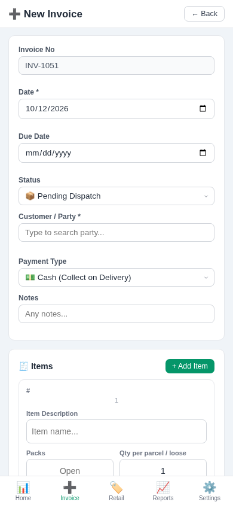
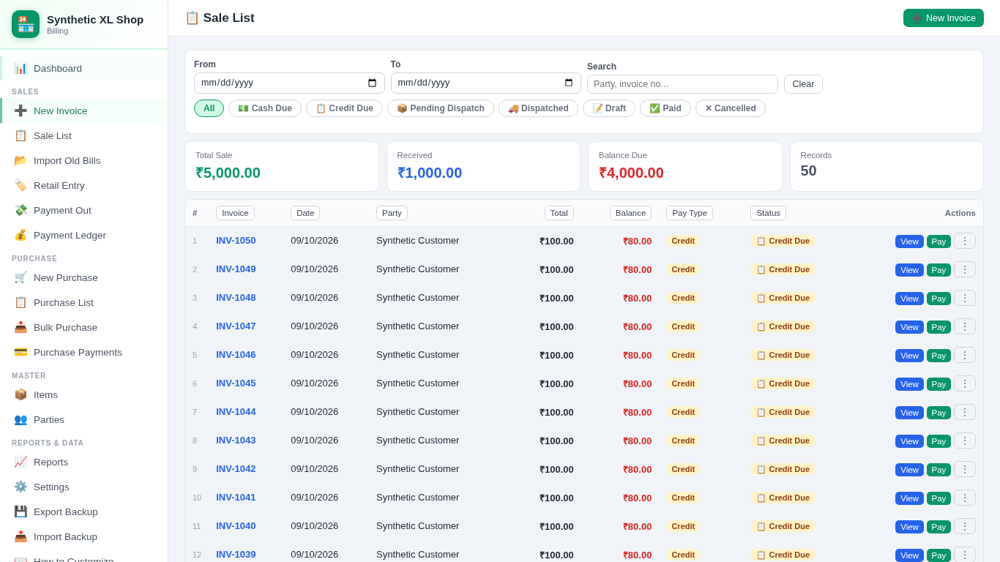

# Owner guide — hotfix test copy

The live app has not been changed. Stabilization and the storage/backup foundation are implemented on draft branches.
Rehearse using a separate synthetic browser profile before considering an upgrade.

## Enter a bill

Open New Invoice. Select the party, add the items, and check the date and total.
For a parcel, enter quantity per parcel and the number of packs. Existing bills
keep their saved final quantity. Save once, then check the invoice on Sale List.

## Find bills and receive money

Use Sale List search and date filters. Rows chooses 20, 50 or 100 records per page.
Next/Prev reaches the rest. Click a column to sort. The summary covers the entire
filtered list. Receive only what is outstanding; an excess payment is rejected.

## Delete PIN

The first delete asks you to set a new PIN. This step does not delete the record.
Choose Delete again, enter your PIN, and confirm with Enter or Delete. Escape or
Cancel closes the dialog. Change the PIN in Settings; supply the current PIN.
**Deletion is still permanent in this draft. Take a backup first.**

## End-of-day routine

Use Export Backup and keep the complete private file outside the browser. It includes
audit, preferences, settings and optional service credentials. Keep earlier copies.
Settings → Independent backups can select a folder for free automatic backups in
compatible browsers. The app must stay open; permission or disk failures show a
reminder. On mobile/unsupported browsers, use manual downloads and confirm the file
was saved. Do not clear browser/site data.

Restore opens a preview. Replacement requires the existing Delete PIN, and a
pre-restore backup download is requested before changes. PIN setup does not restore
automatically; reopen the backup afterward. Unsupported histories are left intact
for review. Reload after a verified restore. New devices need a separate folder
selection; changing the file path or web address does not transfer browser data.

Existing keyboard shortcuts remain. Escape closes the new PIN dialog and Enter
confirms. A complete keyboard-first shortcut redesign is not included yet.
